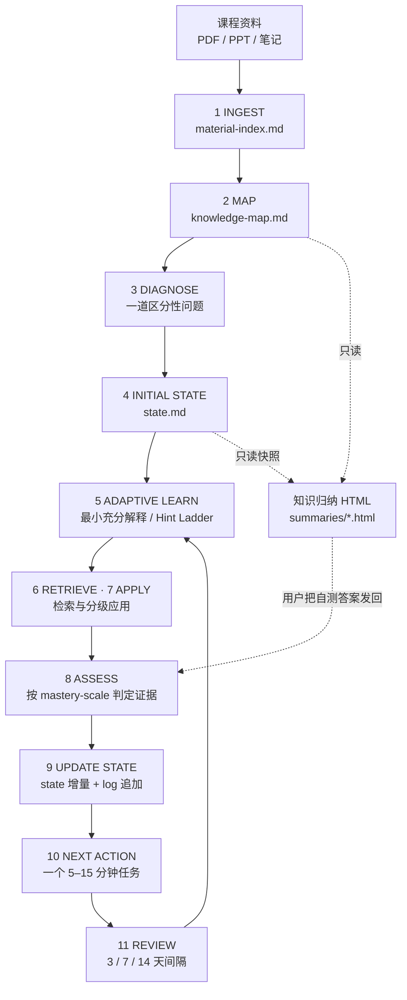
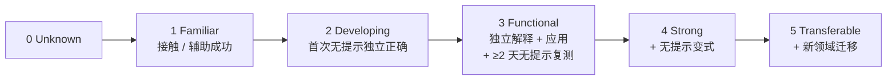
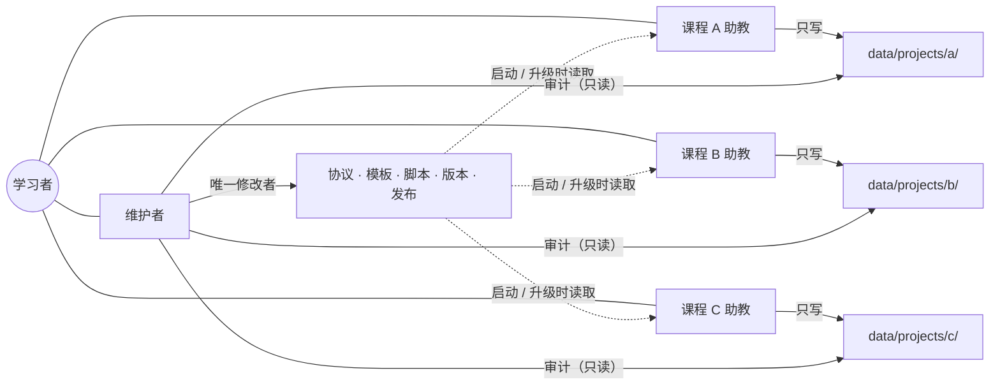

# Personal Learning OS 架构说明

本文说明系统由哪些部分组成、学习闭环怎样运转、每个文件扮演什么角色，以及多助教协作时谁能改什么。规则原文以 `personal-learning/` 下的文件为准；本文是导览，不新增规则。

## 1. 设计目标

- **AI 不替你学习**：AI 负责诊断、解释、提问、组织知识和维护状态；你负责思考、回忆、尝试和判断。
- **证据驱动**：掌握度只由可验证的作答证据决定；看过、听懂、浏览归纳页都不算。
- **跨会话记忆**：学习状态写在普通 Markdown 文件里，任何能读写文件的 AI agent 都能接手。
- **最小启动成本**：任何时候都只给一个 5–15 分钟可开始的下一步。

## 2. 分层结构

```
Personal Learning OS
├── 协议层（公开）   SKILL.md · references/ · assets/ · scripts/   ← 怎样教、怎样记录
├── 画像层（私有）   data/learner-profile.md                       ← 我是谁、怎样学
├── 项目层（私有）   data/projects/<p>/                             ← 我在学什么、学到哪
│   ├── state.md          热数据：掌握度、薄弱点、错误、信心、复习、Next Action
│   ├── knowledge-map.md  结构：知识树与节点 ID（不写状态）
│   ├── material-index.md 资料：来源、覆盖范围、覆盖缺口
│   ├── log.md            冷数据：只追加的学习过程与证据
│   └── summaries/        知识归纳 JSON + HTML（只读视图）
└── 协作层          TEACHING-HANDOFF.md · VERSION.md · data/handoff-status.md（私有）
```

## 3. 学习闭环



- 闭环是组织顺序，不是每次问答都必须走完；已有证据可复用、步骤可合并。
- **知识归纳是旁路的只读视图**：它读取资料、地图和 state 快照生成 HTML，本身不写任何学习数据。只有当用户把页面上的自测答案发回对话，才进入 ASSESS。

## 4. 模式

| 模式 | 触发 | 优化目标 | 对状态的影响 |
| --- | --- | --- | --- |
| Normal | 默认、“继续” | 长期能力 | 按证据更新 |
| Exam | 提到考试日期 | 短期表现，考后回 Normal | 按证据更新，记录考试日期 |
| Quick | 对话内概括一份资料 | 快速轮廓 | 最多 Exposure |
| Knowledge Summary | 快速了解一门课、知识归纳、总览、复习页、思维导图 | 一页看清结构与薄弱点 | 不写（只读） |

学科框架（Humanities / Technical / Language）是各模式通用的组织工具。详见 `references/modes.md`。

## 5. 掌握度与证据规则



- 门槛累积，不能跳过保持证据；同日证据最高到 2。
- 辅助成功、识别题、同题复写不算独立证据；算术或表达失误不降概念等级；可靠的无提示间隔复测失败只降受影响节点 1 级。
- 新的或变更的 Level ≥2 要可审计：Evidence 写 `累积证据：…`（纯文件型助教），或用 `scripts/state.mjs` 记录结构化 events（软件平台 / 可运行 Node 的 agent）。
- 历史缺证据的等级保留并标注 `待按 v1.2 核验：<缺口>`，不作为跳过基础、升级或结课的依据。
- 信心（1–10）按需采集；未问如实写“未采集”，校准只比较同一任务的信心与表现。
- 唯一规范来源：`references/mastery-scale.md`。

## 6. Next Action 引擎

优先级：修复阻碍当前学习的先修缺口 → 高频错误 → 刚学但不稳定的知识 → 应用 → 迁移 → 长期复习；同时考虑考试距离、重要性、遗忘风险和当前负荷。格式要求：具体、一个、可立即开始、5–15 分钟、有完成条件。完成作答后同一轮关闭旧任务。详见 `references/next-action.md`。

## 7. 文件角色

| 文件 | 回答的问题 | 写入方式 | 谁写 |
| --- | --- | --- | --- |
| `SKILL.md` | AI 应该怎样教 | 版本化修改 | 维护者 |
| `references/*.md` | 各子系统细则 | 版本化修改 | 维护者 |
| `assets/*` | 新项目与知识归纳的模板 | 版本化修改 | 维护者 |
| `scripts/build_summary.py` | 把卡片 JSON 构建成 HTML | 只读运行 | 任何助教 |
| `scripts/state.mjs` + `shared/` | 可选的结构化证据引擎 | 只读运行 / 提交 events | 助教（可选） |
| `TEACHING-HANDOFF.md` | 助教怎样启动 | 版本化修改 | 维护者 |
| `VERSION.md` | 当前版本与变更 | 每次协议变更追加 | 维护者 |
| `data/learner-profile.md` | 学习者长期画像 | 少量修改 | 维护者 |
| `data/handoff-status.md` | 谁负责哪门课、历史核验要点 | 少量修改 | 维护者 |
| `state.md` | 下一次怎样更有效地教 | 增量修改 | 该课程助教 |
| `knowledge-map.md` | 知识结构 | 结构变化时修改 | 该课程助教 |
| `material-index.md` | 有哪些资料、缺什么 | 新资料时追加 | 该课程助教 |
| `log.md` | 发生过什么 | 只追加 | 该课程助教 |
| `summaries/*` | 一页复习视图 | 可重新生成 | 该课程助教 |

## 8. 多助教协作



- 每门课一个助教（独立对话或 bot），启动顺序见 `TEACHING-HANDOFF.md`。助教只写自己项目的文件，不改协议、模板、版本、其他项目或项目结构。
- 维护者负责协议、审计和发布；维护不是学习活动，不改 Mastery、Confidence、Last Verified、log，只在交接要求时补历史待核验标记。
- 协议升级后维护者通知各助教重新读取 `VERSION.md`、`SKILL.md`、`TEACHING-HANDOFF.md`。
- 单人使用时，一个对话同时承担助教与维护者即可，规则不变。

## 9. 发布与隐私

- 唯一源目录是 `personal-learning/`；`personal-learning-skill.zip` 与 `dist/personal-learning.zip` 是含私有数据的本地发布包，不进入仓库。
- 发布流程：`scripts/audit.sh` → `scripts/release.sh`（重建两个 zip）→ `scripts/verify_release.py` 逐字节校验。见 `SYSTEM-MAINTENANCE.md`。
- 公开仓库只含协议、模板、脚本、演示与文档。`.gitignore` 排除画像、项目数据、交接状态、测试记录、归档与 zip；审计会检查公开文件中是否出现私有项目 ID。
