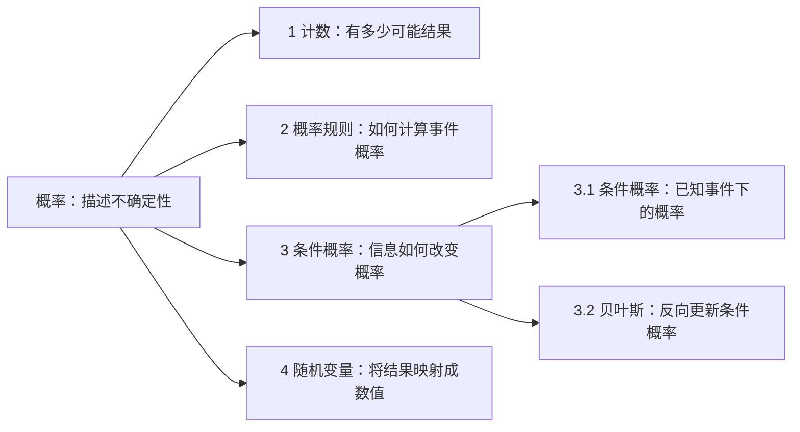

# Mind Map Mode — 思维导图浏览

让用户快速定位“有哪些知识点、各自解决什么问题、彼此怎样连接”。先看全局，再按需展开；输出以短节点和图为主。

## 范围与来源

- 沿用用户指定或当前对话已确认的 Project / 章节 / 主题。存在多个项目且上下文无法确定时，只问一次浏览范围；明确要求跨课程总览时按课程分支保留边界。
- 优先读取目标项目 `knowledge-map.md`，保留其层级和术语。它表示已记录的结构，不保证覆盖完整课程；资料不完整时简短注明范围。
- 地图缺失、过旧或不含目标主题时，按需读取 `material-index.md` 及相关可访问资料。索引标题只能说明覆盖范围，不能冒充已读正文；资料不可用时标明缺口，可提供注明“通用框架”的概念结构，不宣称来自用户资料。
- 用户明确要看掌握度、薄弱点或复习优先项时，再从 `state.md` 读取相关状态；不要从节点的存在、浏览次数或顺序推断掌握。

## 总览与分支

- 首屏通常用“中心主题 → 主要模块 → 核心知识点”的 2–3 层结构，主要模块约 3–7 个；按实际规模调整。过大时先展示上层，用“展开后查看细项”提示，不一次列完整课程。
- 每个节点用“术语：一句核心含义 / 用途”，必要时保留关键条件；公式推导、长例题和练习留给后续请求。中文解释保留常见英文术语，方便对应讲义。
- 默认用 Mermaid `flowchart LR` 展示层级图，节点 ID 用简单字母数字，显示文字用双引号包裹。环境不能渲染或用户指定纯文本时用等价的缩进树；不要让浏览依赖渲染支持。
- 给可展开分支加短编号，图和文字使用同一编号。同一总览的编号在本次浏览中保持稳定；子节点可用 `3.1` 等。这些编号仅用于对话导航，不写回项目文件。
- 在图下用一句话提示可用操作，如“回复‘展开 3’、‘查看关联’或‘返回总览’”。直接满足请求，不附强制诊断、信心自评或练习。

## 导航与关联

| 用户操作 | 响应 |
| --- | --- |
| 展开 3 / 展开某概念 | 显示当前位置，如“ISOM3540 → 3 条件概率”，只展示该分支及必要上下文 |
| 返回上一级 / 返回总览 | 回到对应层级，沿用原编号，不重讲已展示内容 |
| 查看关联 / A 和 B 有什么关系 | 显示少量关键连接，箭头标明“依赖 / 对比 / 应用 / 推导”等关系，区分层级归属与概念联系 |
| 显示掌握度 / 只看薄弱点 | 按状态规则生成临时标注或筛选视图，保留所需父节点 |
| 解释这个点 / 给例子 / 练习 / 继续学习 | 按明确意图进入教学；沿用当前 Normal / Exam 目标及证据规则 |

关联优先来自地图或已读资料；自行补充的合理关系标为“补充连接”，推测注明推测。概念并列不自动意味着因果或先修；主题图中的遗漏不表示该概念不存在。

## 状态与记录边界

- 状态叠加只在本次输出中展示，并注明来源项目与日期。节点与 state 无明确对应时写“未记录”，不要凭近似名称套用整个章节等级或记为 0。
- state 合并记录多个概念时，保留原条目的范围并说明“合并记录”，不将同一等级拆成各节点的独立评分。
- 历史“待按 v1.2 核验”随等级一起显示，不能把历史高等级直接写为“已掌握”。未测试、未记录和证实的薄弱点分别呈现；筛选薄弱点时不把所有未测节点都算作不会。
- `knowledge-map.md` 只保存结构。浏览不会新增第二套状态文件，也不因展示方式、编号或状态变化重写地图；确有结构修正时才增量维护。
- 仅展示已有地图不写学习证据、Exposure、Memory、Confidence、Last Verified、日志或 Next Action。若实际讲到新知识，最多按 Quick Mode 记录明确覆盖节点的 Exposure，不自动升级 Mastery。
- 用户开始独立作答或练习后，才按现行教学流程收集证据并更新相关状态；正常浏览以导航提示结束。

## 输出示例（结构示意）

分支内容根据实际项目生成，示意图不作为任何课程的完整清单或学习证据。
